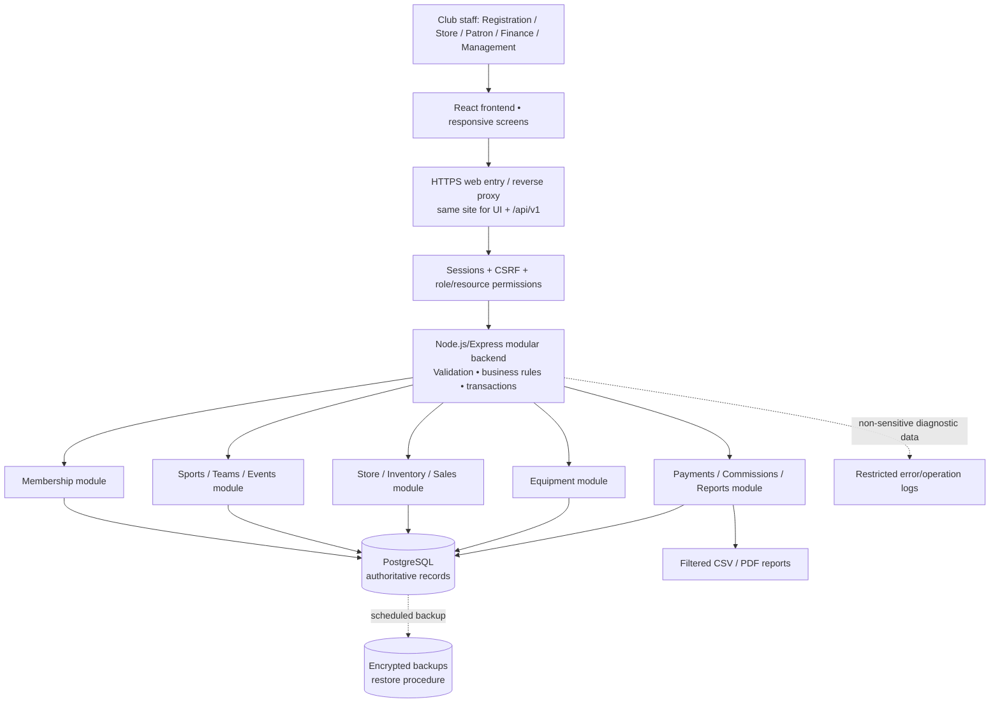
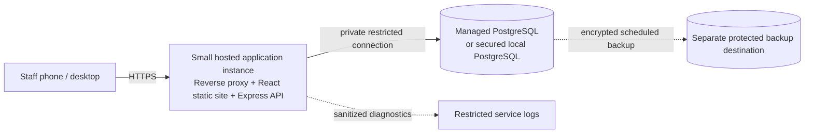

# Maringo Sports Club Management System (MSCMS)
## Step 5 — High-Level System Architecture · v0.1

**Status:** Proposed architecture, not deployed software. Business policies and estimates still require verification.  
**Method:** 1 Million Devs: requirements → estimates → API → data model → **architecture** → bottlenecks and trade-offs. AI Safari: decomposition, user-centred co-design, privacy/dignity, low-bandwidth awareness, debugging and OCEAN verification.  
**Read with:** `docs/requirements.md`, `docs/estimates.md`, `docs/api-design.md`, `docs/data-model.md`.  
**Diagram:** `docs/architecture-overview.mmd`, `docs/architecture-overview.png`.  
**Next:** `docs/tradeoffs.md` — Step 6.

## 1. Decision in one paragraph

Implement a **staff-facing, responsive web application** using **React** in the browser, a **modular Node.js/Express backend**, and one **PostgreSQL relational database**, protected behind HTTPS. Serve browser and API from the same site; authentication uses securely configured HTTP-only session cookies and CSRF protection. Keep all prices, ages, fee rules, permissions, payment verification, and stock changes on the server. For the hypothetical first-year scale (3,000 members; 25 staff accounts; 5–15 concurrent staff), a **modular monolith** with one database is a simpler and more economical starting point than microservices. These numbers are planning assumptions, not club facts.

A modular monolith means **one backend application** with **separately organized feature modules**, not one enormous source file.

## 2. Context and component diagram



**Outside the first release:** live M-Pesa callbacks/payment gateway, SMS delivery, public member login, automatic AI ranking, and distributed service infrastructure. Cash and mobile-money *reference information* may be recorded; a reference entered by an operator **does not prove that a transfer arrived**.

### Trust boundaries

1. **Browser is untrusted.** React collects input and shows previews, but it may be bypassed or manipulated. Validate all writes in Express.
2. **Backend authorizes every operation.** Verify staff account roles **and** resource scope: a patron may only operate on assigned teams/sports; registration staff must not view protected support notes unnecessarily.
3. **Database is the source of truth.** SQL constraints, row locks, transactions, and unique keys protect stock, charges, receipts and histories even during concurrent requests.
4. **External payment evidence is untrusted until verified.** For first release, an authorized procedure verifies received mobile-money payments; never infer verification from the presence of an SMS/reference alone.
5. **Backups/logs are sensitive.** Encrypt and restrict them; logs must avoid credentials, child contact details and special-needs notes.

## 3. User interfaces (frontend)

| Screen area | Typical views | Primary users |
|---|---|---|
| Login/dashboard | Session login, allowed modules, role-aware summary | All authorized staff |
| Members | Search, register individual, import group, consent status, sports priorities, charges | Registration officer |
| Sports/events | Sport catalogue, teams, captains, patron assignments, fixtures, external rosters | Patron / management |
| Store | SKUs, stock receipts, sales drafts, checkout, reorder alerts | Store clerk |
| Equipment | Issue slips, partial returns, condition check, incidents | Clerk / patron / assigned captain |
| Finance | Verify/reverse payments, commission approvals, financial reports | Finance / management |
| Audit/admin | User/role management, approved adjustments, audit trail | Administrator / management |

**UI design guidelines (AI Safari):** Build clear forms for low-end phones and shared desktops; keep bundles small, use pagination and search, show actionable validation messages, keyboard navigation, accessible contrast, and explicit unsaved/loading states. Test flows with actual clerks/registration officers. Do not presume that a youth member has a personal smartphone.

**No member self-service in MVP:** Member profiles are records, not necessarily login accounts.

## 4. Backend architecture: modules and layers

```text
server/
  src/
    app.*                       # Express app, global middleware & error boundary
    config/                     # Environment validation, database settings
    middleware/                 # Session, CSRF, RBAC, rate limiting, audit context
    modules/
      auth/                     # Login, logout, current-user permissions
      members/                  # Members, organizations, registration, guardian consent
      sports/                   # Sports preferences, teams, patrons and captains
      events/                   # Fixtures, rosters, facilitation assessments
      store/                    # SKU catalogue, receipts, stock ledger
      sales/                    # Drafts, pricing, checkout, void review
      equipment/                # Requests, issues, returns, incident review
      finance/                  # Charges, payment allocation, commission, reporting
      reports/                  # Authorized read-only queries & exports
    shared/
      db/                       # Connection pool, transactions, migrations
      money/                    # Exact decimal calculations, rounding convention
      errors/                   # Stable API error objects
      audit/                    # Sanitized audit events
      idempotency/              # Request key + payload hash + replay protection
  tests/
    unit/
    integration/
    concurrency/
client/
  src/
    features/                   # Matching module-specific pages/components
    shared/                     # API client, auth state, form controls
  tests/
database/
  migrations/                   # Version-controlled SQL migrations
  seeds/                        # Fake demo data only
docs/                           # Six-part 1 Million Devs design
```

**Within each backend feature** follow the same basic layering:

`HTTP route → authentication/authorization → input validation → service/business rules → database query/repository → PostgreSQL → safe API response`.

This is an organizational proposal, not code already written. Choose TypeScript when implementation begins to improve validation and maintainability; avoid prematurely installing many dependencies.

### API contract compatibility

Existing routes under `/api/v1` remain as documented in Step 3, for example:

- `POST /members`, `POST /group-registrations`, `PUT /members/{id}/sports-preferences`
- `POST /events`, `POST /events/{id}/finalize-roster`
- `POST /sales`, `POST /sales/{id}/checkout`
- `POST /equipment-loans`, `POST /equipment-loans/{id}/issue`, `POST /equipment-loans/{id}/returns`
- `POST /equipment-incidents/{id}/confirm`, `POST /payments`, `GET /reports/income`

If behavior changes during implementation, update **both** API and data-model documents before silently changing code.

## 5. End-to-end data flows

### A. Registering an individual or group member

1. Registration officer signs in; frontend loads allowed sports and organization options.
2. Officer enters member identity, full birth date, relevant contact/next-of-kin details, group affiliation and ranked sports interests.
3. `POST /api/v1/members` (or `POST /api/v1/group-registrations`) sends validated fields with an `Idempotency-Key`.
4. Backend checks role, request shape, enrollment age (12–35), duplicate indicators, group/individual rules and guardian-consent requirement for minors.
5. In **one database transaction**, create member, membership, preferences, fee charge and its membership-charge source; for minors, registration cannot be **activated** without appropriately verified guardian permission. Partial/incomplete applications may remain restricted drafts if that workflow is later approved.
6. Commit then reply with assigned member number, age band, assessed amount (individual KSh 1,000 or group KSh 500 per person) and **payment outstanding**. Payment verification occurs separately.
7. A retry using the same key/payload returns the same result without duplicating member or fee; a mismatched payload with same key returns conflict.

**Important:** Group import should report row-specific errors without leaking sensitive information or leaving half-posted fee charges. Whether one import is all-or-nothing or allows validated rows needs a clear UX choice; the backend must define it consistently and document the chosen semantics.

### B. Sale checkout, stock and payment

**Goal:** Avoid selling the same last item twice or counting payment twice.

1. Store clerk creates a draft `POST /sales`. Server reads catalogue prices, calculates sale lines, applies **5% discount only if subtotal > KSh 10,000**; UI displays an indicative amount.
2. Cash sale: the authorized clerk confirms physical payment as per cash-handling policy. Mobile money: record pending payment with reference; an authorized person must verify settlement by an approved process. **An unverified mobile reference cannot trigger completed checkout.**
3. On verified checkout request `POST /sales/{id}/checkout`, begin a **single PostgreSQL transaction**.
4. Validate actor, key uniqueness, sale state, actual verified tender amount, and server-calculated total; lock all affected `inventory_balances` rows in stable item-ID order or perform equivalent atomic conditional updates.
5. Confirm quantities are available; create immutable sale/payment evidence and `stock_movements`, reduce `inventory_balances.available_qty`, finalize receipt number and sale status, and store replay result. All these steps commit together, or **all roll back**.
6. After commit, compute/display low-stock warning when `available_qty <= 0.20 * maximum_stock_level`, and issue receipt/summary. A checkout retry does **not** sell twice.

**Payment nuance:** A pending mobile payment may outlast the draft sale. In MVP, no stock is reserved by a draft; when the payment is confirmed, the backend must **recheck stock**. If stock became unavailable, escalate for manual resolution/refund instead of posting a fictional sale or negative inventory.

**Reversal nuance:** A refunded sale does not automatically restock goods unless the goods were actually returned and inspected; financial reversal and physical stock return require distinct auditable operations. Validate this before implementing the `/sales/{id}/void` workflow.

### C. External event fees and patron commission

1. Patron schedules event, assigns a valid team and participating members.
2. Patron finalizes eligible roster once using `POST /events/{id}/finalize-roster`; one external event creates **KSh 500** member charge per finalized participant; an internal event does not.
3. Finance records/validates collected amounts in `payments` and `payment_allocations` without double counting.
4. Patron commission is proposed as **20% of net verified facilitation receipts**; keep its basis and rate snapshot on the event commission record.
5. After finance/management approval, payout is recorded once as an **expense**, not extra club income. Reverse or recalculate if receipts are subsequently reversed, per approved policy.

**Open policy:** The problem says commission on total facilitation fee. Whether that means billed fees or collected fees remains unresolved. Do not hard-code the proposed collected-basis rule until the club approves it.

### D. Issue, return, loss and damage

1. Valid captain requests equipment for the related team/event.
2. Clerk verifies availability and issues specified quantities using one transaction: `available -n`, `issued +n` plus a traceable stock movement.
3. On return, clerk records quantity and condition; usable returned items move `issued -n`, `available +n`; damaged returned items move `issued -n`, `damaged +n`.
4. A reported loss is reviewed, approved and recorded by an authorized person, moving missing units out of `issued` **once**.
5. Surcharge for approved incident = damaged/lost quantity × recorded market value × **1.10**. Store the snapshot valuation and reasons.
6. Allocation to captain and individual members must be **blocked** pending policy approval; do not multiply one team's incident surcharge by every member.

### E. Reports

1. Finance/management requests an authorized date-filtered report, e.g. `GET /reports/income?from=...&to=...`.
2. Backend performs filtered/paginated reporting queries or a bounded export job on the main database.
3. Report distinguishes **assessed charges**, **verified money collected**, **reversals/refunds**, and **commission paid**; joins prevent duplicate sale/charge counting.
4. Generated CSV/PDF is restricted to authorized users and excludes private member details unless the report purpose genuinely requires them. Very large exports should be generated in a controlled job if future volumes demand it.

## 6. Security, ethics and safeguarding by design

| Risk | Architecture control |
|---|---|
| Unauthorized staff records access | Session login; per-route AND per-record RBAC; minimum permissions |
| Child information leakage | Separate restricted guardian/next-of-kin/support details; no public member API; safe exports |
| Invalid minor enrollment | Calculate age from full date of birth; guardian-authorization workflow, restricted draft status |
| Payment/reference spoofing | Status `pending` until verified against approved evidence, maker-checker for corrections |
| Duplicate requests | Idempotency keys, unique constraints, transactional retries |
| Forged prices, ages, discounts | Server authoritative calculations and validation |
| Accidental/deliberate stock changes | Append-only movements, approval for adjustments, reconciliations and audit logs |
| Password theft/session misuse | Salted password hashing, HTTPS, secure HTTP-only SameSite cookies, CSRF, session expiry, login throttling |
| Data lost after device or server failure | Encrypted scheduled database backups, restricted credentials, periodic restore tests |
| Lost/damaged equipment disputes | Condition/time/actor evidence, manual incident approval, documented right of review |

**Data minimization:** Special-needs notes and weight/height should only be collected where justified for the club purpose, with appropriate safeguards and retention. Avoid publishing names or identifying details of minors in demonstration datasets, console logs, screenshots or GitHub. Apply applicable Kenyan data-protection and child-safeguarding requirements after validating real operational practices.

**AI Safari OASIS/ETHOS:** Obtain appropriate permission; collect only needed information; protect human dignity and children; retain data for approved periods; make human review available for high-impact decisions. No AI-driven eligibility scoring is required for this management system.

## 7. Deployment and infrastructure (MVP)



Recommended first deployment: a simple managed hosting setup or low-cost virtual server with TLS/HTTPS and one PostgreSQL database. Choose region, provider and residency arrangement **after** the club validates privacy obligations, reliability expectations, affordability and connectivity. Keep DB connection credentials out of Git; configure secrets through environment/secret management. Database should not be publicly reachable, and API/database access should be restricted by network policies.

- **Development:** local React/Express/PostgreSQL, dummy member records; automated tests.
- **Staging:** same schema and key settings as production, with fictitious data; run migrations, smoke tests and recovery drills.
- **Production:** separate secrets, HTTPS, least-privilege accounts, routine database backup/restore verification, monitoring and authorized staff onboarding.

Use timestamped, version-controlled database migrations. Back up data before destructive production migrations; rehearse rollbacks and backup restore.

**Backup objective (proposed, not a guarantee):** at minimum, scheduled daily encrypted backups with off-server copies and restore testing. For a club where losing a day's receipts is unacceptable, negotiate a smaller Recovery Point Objective (RPO) through more frequent backups / WAL archiving. Recovery Time Objective (RTO) must be measured in a practice restore before promising a value.

## 8. Reliability, concurrency and time

- PostgreSQL transactions ensure that a sale's payment, receipt, stock ledger and inventory balance are posted together.
- Use row locks or conditional atomic updates to prevent overselling and over-issuing, and a consistent lock order to reduce deadlocks.
- Place `Idempotency-Key` on financial/event finalization, issue/return and bulk registration actions; enforce with DB unique constraints.
- Never trust money calculated in the browser; represent KSh amounts in exact decimal / database `NUMERIC(12,2)`. Define and test a consistent rounding policy.
- Persist timestamps in UTC using `TIMESTAMPTZ`; display and collect local dates with the `Africa/Nairobi` timezone where appropriate. `DATE` for birth date is not a timestamp.
- Paginate searches, index lookup and filter columns, and avoid fetching thousands of members in one browser render.
- If there is no connectivity, **do not pretend** that payments, checkout or stock issues are committed. Show an honest offline state. Optional read-only caching may be considered after testing privacy on shared devices. Offline write queuing of financial/stock actions is deferred because it risks double posting and conflicting quantities.

## 9. Failure scenarios and expected recovery

| Failure | Expected behavior |
|---|---|
| Browser closes during member registration | If DB committed, retry with same idempotency key retrieves same member; otherwise safe new attempt |
| Internet disconnects after clerk clicks checkout | UI says status unknown and safely refreshes/retries by same key; no duplicate sale |
| Two clerks sell final available stick | One finalizes; the other receives clear insufficient-stock response |
| M-Pesa reference copied but no confirmed settlement | Payment stays pending; do not finalize a mobile sale |
| Device goes offline during equipment issue | No server-side issue recorded; show uncommitted request and recheck before physical handover |
| Patron finalizes same roster twice | Unique per-participant fee and idempotent finalization avoid duplicate charges |
| Database unavailable | Reject writes safely; no local "success" claims; alert operator; restore verified backups as needed |
| User tries to read protected minor notes | 403; no private fields returned and restricted audit of access attempt |
| Staff reverses a sale after goods have left store | Financial reversal does not silently add stock back; return/inspection workflow needed |

## 10. Testing strategy (by layer)

- **Unit:** age on birthday, 12/17/18/25/26/35 age boundaries; KSh 1,000/500; discount threshold at 10,000 vs 10,001; fee 500; commission 20%; surcharge 110%; stock threshold at 20%.
- **Integration:** member+membership+charge atomic creation; register minor + consent safeguards; sale stock and payment transaction; equipment issue/return ledger; event fee creation; income reconciliation.
- **Authorization:** test unauthorized cross-team access, profile field-level response filtering, finance-only reversing and audit-log protection.
- **Concurrency:** two final-stock checkouts; double-click/replayed checkout; simultaneous equipment issues; double roster finalization; duplicate mobile reference handling.
- **Recovery:** API restart mid-operation, DB unavailable at checkout, interruption after server commit, backup restore, migrated schema verification.
- **Usability:** registrar and clerk can complete common tasks on low-bandwidth/entry-level devices; check accessibility and print/export quality.

**Target evidence:** Repeatable tests, sample fake records and acceptance evidence should accompany the code; not only screenshots that look correct.

## 11. Design choices, boundaries and deferred items

| Area | MVP decision | Why |
|---|---|---|
| Architecture | Modular monolith | Simpler development, security and deployment for staff-focused workload |
| Persistence | One PostgreSQL database | Relational integrity and atomic transactions |
| UI | React responsive web app | Shared browser access without mandatory app install |
| Payment | Cash recording and manually verified M-Pesa references | No provider integration credentials/reconciliation specified |
| Inventory | Quantity-based stock and ledger | Matches stated brief; individual equipment tagging is optional future enhancement |
| Reporting | Database-derived filtered views + CSV/PDF export | Avoid separate analytics infrastructure initially |
| Offline | Clear offline/retry UX; defer offline money/stock writes | Conflicts and privacy risk on shared devices |
| Automation | Reorder warnings inside UI, not automatic purchases | Human authorization for supplier orders |
| AI features | None required | Human-led, rules-based system is sufficient |

## 12. Outstanding policy decisions

Do not infer or silently implement these as accepted facts:
1. Sports catalogue: the brief says 16 sports but lists 15.
2. Membership: first-time one-off vs renewal; treatment as member ages beyond 35.
3. Exact process/evidence for guardian consent.
4. Whether event commission base is fees **charged** or fees **verified/collected**.
5. How team surcharge responsibility is divided without double billing or harming children.
6. Individual equipment asset tracking vs pooled quantity stock.
7. Payment maker/checker roles, cash receipt verification, dispute/refund policy.
8. Allowed storage location, backup/retention schedule and data export permissions.
9. Group import policy: all-or-nothing vs valid-only records with row errors.

## 13. Step 6 handoff — bottlenecks and trade-offs

Step 6 (`docs/tradeoffs.md`) will evaluate:
- concurrent stock writes and deadlocks;
- failed or delayed payment verification and retry semantics;
- group-registration bursts and duplicate detection;
- report-heavy periods versus transaction responsiveness;
- loss of connectivity/power and low-cost deployment reliability;
- audit storage, privacy, access control and backups;
- what to optimize now versus only after measured load.

**Proposed Git commit:** `docs: define MSCMS system architecture and transaction flows`.

**Definition of done for Step 5:** Diagrams render; routes match Step 3; tables match Step 4; at least one complete registration/sale/equipment/event flow is described; critical failure/privacy cases have explicitly documented handling; MVP exclusions are clear. Approval of open policies still required before physical database migrations and business-rule implementation.
