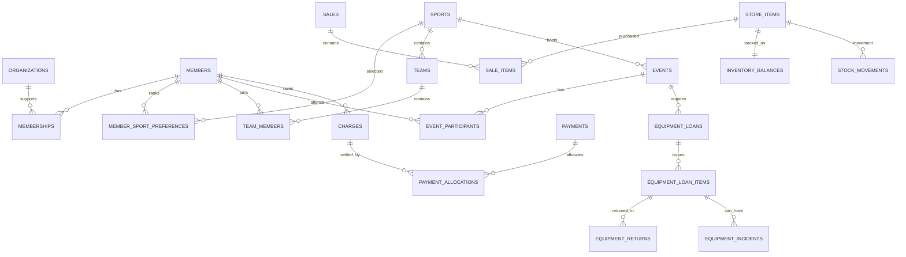

# Maringo Sports Club Management System (MSCMS)
## Step 4 — Relational Database Design · v0.1

**Status:** Proposed database design, **not a deployed schema**. The source brief and design decisions still need validation.  
**Method:** 1 Million Devs: requirements → estimates → API → **data model** → architecture → trade-offs. AI Safari: decomposition, abstraction, user-centered design, context awareness, ETHOS/OASIS data care, and systematic verification.  
**Inputs:** `docs/requirements.md`, `docs/estimates.md`, `docs/api-design.md`.  
**Diagrams:** `docs/erd-overview.mmd` (overview), `docs/erd-members-and-events.mmd`, `docs/erd-store-and-equipment.mmd`.  
**Next:** `docs/architecture.md` (Step 5).

## 1. Why a relational database?

- Members participate in many sports and events; many members can select the same sport. These are **many-to-many** relationships, represented with junction tables.
- Keep one authoritative member profile; avoid copying names and dates of birth into each sale, event and payment.
- Keep historical **financial amounts and inventory movements**; a changed catalogue price must not alter old receipts.
- PostgreSQL provides foreign keys, `NUMERIC` values for KSh, transactions, constraints, indexing and reliable concurrent stock changes. A **single database** is appropriate for estimated Year 1 scale; no sharding or microservices needed.
- **Privacy by design**: keep guardian/contact details and optional support details apart from public/non-sensitive member fields, and apply restricted API permissions.

### A small example of normalization

**Wrong approach:** one `members` row containing `sport_1`, `sport_2`, `sport_3`, `sport_4` and repeated event fields. This limits choices and creates duplication.

**Better approach:** `members (id, ...)`, `sports (id, name)`, and `member_sport_preferences (member_id, sport_id, priority)`. For member M001, rows can be (Football, 1), (Basketball, 2), (Volleyball, 3).

## 2. Design conventions

| Concern | Decision | Reason |
|---|---|---|
| Database | PostgreSQL | Strong foreign-key and transaction support |
| Internal primary keys | UUID (`id`) | Stable identifiers across modules; don't expose predictable sequence identifiers to public clients |
| Human-readable IDs | `membership_number`, `receipt_number`, `sku`, `event_code` unique | Easy to quote to staff, but not primary keys |
| Names | `snake_case`, plural table names | Consistent and readable |
| Prices, fees, amounts | `NUMERIC(12,2)` with `CHECK (amount >= 0)` where applicable | Exact KSh monetary arithmetic; do not use floating point |
| Quantities | `INTEGER` with appropriate nonnegative checks | Prevent invalid stock state |
| Dates | `DATE` for birth/event date; `TIMESTAMPTZ` for transaction timestamps | Correct age calculation and audit timing; display Africa/Nairobi locally |
| Statuses | Explicit controlled values with `CHECK` or enum, and controlled state transitions | Prevent impossible lifecycle states |
| Foreign-key deletion | Generally `RESTRICT` for historical transactions; use archive/inactive flags | Preserve audit/history |
| Sensitive fields | Minimal collection, separate restricted tables, encryption as appropriate | Protect minors and other members |
| Audit | `created_at`, `updated_at`, actor references and append-oriented `audit_logs` | Accountability without logging personal secrets |

`PK` = primary key; `FK` = foreign key; `UQ` = unique constraint. In table descriptions, `id` means a UUID PK unless otherwise noted. `FK → table` means a reference to `table.id` unless specified.

## 3. Table catalogue / data dictionary

### A. Accounts and permissions

| Table | Important fields and relationships | Required rules |
|---|---|---|
| `users` | `id` PK, `full_name`, `email` UQ, `password_hash`, `is_active`, timestamps | Staff login accounts **not** the same as member profiles; hash passwords |
| `roles` | `id` PK, `code` UQ (`ADM`, `REG`, `STO`, `PAT`, `CAP`, `FIN`, `MGT`), `name` | Seed permitted codes; staff roles granted deliberately |
| `user_roles` | `user_id` FK → users, `role_id` FK → roles; composite PK `(user_id,role_id)` | A staff user can have multiple approved roles; backend checks exact resource access |

**Captain note:** a captain is a *member assignment* in `captain_assignments`, not necessarily a staff account. `CAP` is an optional authenticated permission for captain self-service, and must be linked to the relevant member identity before enabling it.

### B. Members and registration

| Table | Important fields and relationships | Required rules |
|---|---|---|
| `organizations` | `id` PK, `name`, `type` (`school`/`college`/`religious`), `contact_name`, `contact_phone`, timestamps | Supports group enrollment; check likely duplicate organizations |
| `group_registrations` | `id` PK, `organization_id` FK, `submitted_by_user_id` FK, `submitted_at`, `status`, `reference_code` UQ | One import/enrollment batch can include many members; retain row-level errors in service logs without leaking sensitive data |
| `members` | `id` PK, `membership_number` UQ, `full_name`, `gender`, `date_of_birth`, `phone`, `sub_county`, `school_or_college`, `status`, timestamps | Date of birth is authoritative; age calculated from full DOB, never saved as an unchanging value |
| `member_contacts` | `id` PK, `member_id` FK, `contact_type` (`next_of_kin`/`guardian`), `full_name`, `relationship`, `phone`, `is_primary` | Restrict visibility; do not automatically assume next of kin is a legal guardian |
| `guardian_consents` | `id` PK, `member_id` FK, `guardian_contact_id` FK → member_contacts, `consent_purpose`, `status`, `verified_at`, `verified_by_user_id` FK, `evidence_reference` | For minors, require appropriately verified parent/guardian authorization before activation; no exposed evidence in normal reports |
| `member_support_details` | `member_id` PK/FK → members, `weight_kg`, `height_cm`, `special_needs_notes`, `purpose`, `updated_at` | Sensitive, optional; tightly restrict, validate ranges; avoid collecting unnecessary details |
| `memberships` | `id` PK, `member_id` FK, `registration_type` (`individual`/`group`), `organization_id` FK nullable, `group_registration_id` FK nullable, `registered_on`, `status` | Group ⇒ organization present; individual ⇒ organization absent; initial-age eligibility 12–35; renewal not assumed |
| `member_sport_preferences` | composite PK `(member_id, sport_id)` FKs, `priority` integer | UQ `(member_id, priority)`; priorities positive, distinct; replacement in single transaction |

**Age bands** are derived in application/report queries from DOB *as of a named date*: `12–17` minor, `18–25` middle, `26–35` senior. Do not store a stale category on `members`. Maintain `registered_on` and a historic DOB change audit so original enrollment decisions remain explainable.

### C. Sports, teams and events

| Table | Important fields and relationships | Required rules |
|---|---|---|
| `sports` | `id` PK, `name` UQ, `is_active` | Seed the 15 names explicitly listed; source saying 16 needs clarification |
| `patron_assignments` | `id` PK, `sport_id` FK, `user_id` FK → users, `starts_on`, `ends_on` | One active patron per sport *at a time* unless policy is revised; preserve past assignments |
| `teams` | `id` PK, `sport_id` FK, `name`, `status` | UQ `(sport_id, name)` (subject to historical naming policy) |
| `team_members` | `id` PK, `team_id` FK, `member_id` FK, `joined_on`, `left_on` | Prevent duplicate *active* assignment to same team; keep history |
| `captain_assignments` | `id` PK, `team_id` FK, `team_member_id` FK → team_members, `appointed_by_patron_assignment_id` FK, `starts_on`, `ends_on` | Assigned captain must belong to this team; one active captain/team; preserve history |
| `events` | `id` PK, `event_code` UQ, `sport_id` FK, `team_id` FK, `patron_assignment_id` FK, `event_type` (`internal`/`external`), `event_date`, `opponent`, `venue`, `status`, `roster_finalized_at` | Team's sport must match event sport; external participation charges only on roster finalization |
| `event_participants` | `id` PK, `event_id` FK, `member_id` FK, `participation_status`, `added_at` | UQ `(event_id, member_id)`; verify eligibility/team policy; locked roster for billing |

### D. Charges, collections and commissions

**Design choice:** all *member debts* share `charges`, whereas *cash collected* lives in `payments`; `payment_allocations` connects a payment to one or more charges. Sales are handled as a separate `sale_id` payment purpose to prevent double counting.

| Table | Important fields and relationships | Required rules |
|---|---|---|
| `charges` | `id` PK, `member_id` FK, `charge_type` (`membership`/`facilitation`/`surcharge`), `amount`, `status`, `assessed_at`, `voided_at` | Every charge has exactly one source record; bill amount is **not** received income |
| `membership_charges` | `id` PK, `membership_id` FK UQ, `charge_id` FK → charges UQ, `fee_rate_snapshot` | Charge individual KSh 1,000; group KSh 500; one initial fee per membership |
| `facilitation_charges` | `id` PK, `event_participant_id` FK UQ, `charge_id` FK → charges UQ, `fee_rate_snapshot` | Only external events; KSh 500 per member, once per finalized roster |
| `payments` | `id` PK, `payment_type` (`charge`/`sale`), `sale_id` FK nullable, `payer_member_id` FK nullable, `method` (`cash`/`mobile_money`), `amount`, `reference`, `status` (`pending`/`verified`/`reversed`), `recorded_at`, `verified_at`, `verified_by_user_id` FK | Sale payments reference a sale and have no charge allocations; charge payments have allocations; mobile reference entry alone ≠ verified payment |
| `payment_allocations` | `id` PK, `payment_id` FK, `charge_id` FK, `amount` | Each confirmed allocated KSh counted once; per-payment allocation sum ≤ payment amount; charge paid sum ≤ charge amount |
| `payment_reversals` | `id` PK, `payment_id` FK UQ, `reason`, `authorized_by_user_id` FK, `reversed_at`, `reversal_reference` | MVP: full-payment reversals only, with compensating stock action if reversing a sale; never erase original |
| `patron_commissions` | `id` PK, `event_id` FK UQ, `patron_assignment_id` FK, `commission_rate_snapshot`, `eligible_fee_base`, `commission_amount`, `status`, `approved_by_user_id` FK | Proposed base = net **verified** facilitation payments; rate 20%; one commission account per event; reconcile after refunds |
| `commission_payouts` | `id` PK, `patron_commission_id` FK, `amount`, `method`, `reference`, `paid_at`, `recorded_by_user_id` FK | Payout is a **club expense**, not member-payment income; sum of payouts ≤ approved commission |

**Deliberately deferred:** multi-tender sales, partial refunds, complex general-ledger accounting, renewals and automatic bank/M-Pesa reconciliation. They need explicit policies and extensions. Full-payment reversals must be controlled and audited.

### E. Sales and store inventory

| Table | Important fields and relationships | Required rules |
|---|---|---|
| `store_items` | `id` PK, `sku` UQ, `name`, `variant`, `unit_price`, `is_sellable`, `is_loanable`, `is_active` | Sports-shoe variants each have a real fixed KSh price within specified range; unit price not trusted from browser |
| `inventory_balances` | `store_item_id` PK/FK, `available_qty`, `issued_qty`, `damaged_qty`, `maximum_stock_level` | Every quantity ≥ 0; <=20% low-stock rule uses **available** stock; write atomically with movements |
| `stock_receipts` | `id` PK, `received_at`, `received_by_user_id` FK, `supplier_reference` | Incoming-stock header; receipt lines hold quantities |
| `stock_receipt_lines` | `id` PK, `stock_receipt_id` FK, `store_item_id` FK, `quantity` | Each line has positive quantity; receiving increases available stock |
| `stock_adjustments` | `id` PK, `created_by_user_id` FK, `approved_by_user_id` FK, `reason`, `status`, `created_at` | Adjustments require approval; never silently change stock |
| `stock_adjustment_lines` | `id` PK, `stock_adjustment_id` FK, `store_item_id` FK, `available_delta` | Signed adjustment; cannot produce negative balance |
| `sales` | `id` PK, `receipt_number` UQ nullable until final, `member_id` FK, `sold_by_user_id` FK, `status`, `subtotal`, `discount_amount`, `total_amount`, `finalized_at` | Server calculates discount when `subtotal > 10000`, and locks amount on finalization |
| `sale_items` | `id` PK, `sale_id` FK, `store_item_id` FK, `quantity`, `unit_price_snapshot`, `line_total` | Positive quantity; captured price immutable after checkout |
| `stock_movements` | `id` PK, `store_item_id` FK, `available_delta`, `issued_delta`, `damaged_delta`, `movement_type`, `recorded_at`, `recorded_by_user_id` FK, one source reference | Append-only ledger; item balance updates and movement write in **same DB transaction** |

**Stock movement sources:** use **nullable, real foreign-key columns**, not an unchecked `source_type/source_id` string pair: `sale_item_id`, `stock_receipt_line_id`, `stock_adjustment_line_id`, `equipment_loan_item_id`, `equipment_return_id`, `equipment_incident_id`. Exactly **one** must be non-NULL (`num_nonnulls(...) = 1`). Use unique source/movement rules and API idempotency to prevent duplicate application.

Movement examples (available / issued / damaged):

- Receive 5 items: `(+5, 0, 0)`
- Sell 2 items: `(-2, 0, 0)`
- Issue 3 items: `(-3, +3, 0)`
- Return 2 usable items: `(+2, -2, 0)`
- Return 1 damaged item: `(0, -1, +1)`
- Confirm 1 lost issued item: `(0, -1, 0)`

These deltas preserve the distinction between sales and loans. Items in damaged quarantine are not available for sale or issue. The **available** count is what drives reorder alerts; verify with club stock policy.

### F. Equipment loans and incidents

| Table | Important fields and relationships | Required rules |
|---|---|---|
| `equipment_loans` | `id` PK, `event_id` FK, `team_id` FK, `captain_assignment_id` FK, `requested_at`, `issued_at`, `status`, `issued_by_user_id` FK | Validate captain belongs to event's team; log request, issue and return state |
| `equipment_loan_items` | `id` PK, `equipment_loan_id` FK, `store_item_id` FK, `quantity_requested`, `quantity_issued`, `condition_on_issue` | Only loanable SKUs; issued quantity ≤ available; partial returns possible |
| `equipment_returns` | `id` PK, `equipment_loan_item_id` FK, `quantity`, `condition` (`good`/`damaged`), `received_at`, `received_by_user_id` FK | Multiple partial returns; total returned quantities cannot exceed issued quantity |
| `equipment_incidents` | `id` PK, `equipment_loan_item_id` FK, `incident_type` (`lost`/`damaged`), `quantity`, `unit_market_value_snapshot`, `total_surcharge_amount`, `status`, `approved_by_user_id` FK, `approved_at` | For an approved incident: `quantity × market value × 1.10`; retain evidence and human review |
| `surcharge_allocations` | `id` PK, `equipment_incident_id` FK, `member_id` FK, `charge_id` FK → charges UQ, `allocated_amount`, `policy_note` | Only after approved sharing policy; sum of allocations = incident surcharge, **not** N × full surcharge |

**Important:** For damaged returns, an incident records the assessed damage without *another* stock deduction. Loss is a separate incident/movement. Issue, return, lost and damaged quantities must reconcile per loan item.

### G. Technical accountability

| Table | Important fields and relationships | Required rules |
|---|---|---|
| `idempotency_keys` | `id` PK, `scope`, `key`, `request_hash`, `response_reference`, `status`, `created_at`, `expires_at` | UQ `(scope,key)`; same key+same payload returns original result, mismatched payload rejected |
| `audit_logs` | `id` PK, `actor_user_id` FK nullable, `action`, `entity_type`, `entity_id`, `created_at`, `metadata_summary` | Append-only; do not store passwords, special-needs notes or children's private details in logs |

## 4. Essential relational links

The additional `.mmd` files provide a larger editable overview and focused diagrams for members/events and store/equipment. They can be viewed in Markdown viewers supporting Mermaid, on GitHub, or in Mermaid Live Editor.

## 5. Referential integrity and constraints to enforce

**At the database level (where possible):**

1. Unique member numbers, event codes, SKUs, receipt numbers and login emails.
2. Unique sports `(member_id, sport_id)` and ranks `(member_id, priority)`.
3. Unique roster `(event_id, member_id)` and unique facilitation charge per event participant.
4. Unique membership charge per membership and charge source, and single current captain/patron assignment according to dates.
5. FKs prevent references to nonexistent members, events, teams, charges, stock items or users.
6. Monetary values not negative unless in explicit adjustment/reversal ledger; stock balance fields ≥ 0.
7. `registration_type='group'` requires organization link; `individual` forbids one.
8. Positive stock quantities, item counts, loan quantities and sport priorities.
9. Payment `sale_id` association consistent with `payment_type`; unique verified external references in the appropriate payment-provider scope.
10. No direct delete of posted transactions; archived/inactive/void states preserve evidence.

**In server transactions plus database locks/constraints:**

1. Calculate age **on registration date**; block new applicants outside 12–35 and require verified guardian consent for minors.
2. Validate assigned captain belongs to the team; event sport matches team's sport; patron is authorized.
3. Keep charge-specific source rows consistent with `charges.charge_type` and `charges.member_id`.
4. Restrict fee charging to external-event participants and prevent duplicate finalization on retries.
5. Enforce sums: allocated payments ≤ verified payment, allocation balance ≤ charge, surcharge shares = approved incident total, commission payouts ≤ approved commission.
6. Apply stock movements, balance updates and payment finalization **atomically**; lock affected inventory rows before checkout/issue.
7. Ensure returns + confirmed missing quantities never exceed units issued; avoid counting damaged returns twice.
8. Do not post mobile-money receipts as verified without approved manual verification or a future provider callback.

**Why not only frontend validation?** Users can bypass the browser and send direct API requests. The database/backend must be authoritative.

## 6. Business calculations: their source tables

| Calculation | Authoritative inputs | Rule |
|---|---|---|
| Age/category | `members.date_of_birth`, relevant date | Minor 12–17; Middle 18–25; Senior 26–35 |
| Membership fee | `memberships.registration_type`, `membership_charges.fee_rate_snapshot` | Individual KSh 1,000; group KSh 500 per person |
| Sale subtotal | `sale_items.quantity`, `unit_price_snapshot` | Sum of line totals |
| Sale discount | `sales.subtotal` | 5% **only if** subtotal > KSh 10,000 |
| Sale total | `sales.subtotal`, `discount_amount` | Subtotal − discount |
| Low stock | `inventory_balances.available_qty`, `maximum_stock_level` | Alert when available ≤ 20% maximum |
| External event fee | `event_participants`, `facilitation_charges` | KSh 500 per roster-finalized member |
| Patron commission | Net verified event-fee allocations and rate snapshot | 20% of **provisionally chosen collected basis**, subject to approval |
| Equipment surcharge | Incident quantity and snapshot market value | Total = quantity × market value × 1.10 |
| Collected income | Verified payments, less reversals | Member fees + facilitation fees + sale receipts + surcharge receipts; each KSh counted once |
| Patron expenses | `commission_payouts` | Expenditure, not income |

**Reconciliation rule:** report billed fees and collected receipts separately. Draft/unverified payments do **not** count as collected income. The `payments` and `payment_allocations` model cannot permit money counted once as a sale and again as a charge.

## 7. First implementation slice: minimum viable tables

We will **not build all tables at once**. Phase 1 begins with these foundational tables (and the specific permissions/data-privacy controls):

1. `users`
2. `roles`
3. `user_roles`
4. `organizations`
5. `group_registrations`
6. `members`
7. `member_contacts`
8. `guardian_consents`
9. `memberships`
10. `sports`
11. `member_sport_preferences`
12. `charges`
13. `membership_charges` (the subtype linking each fee to its membership)

Add `payments`, `payment_allocations`, `payment_reversals`, `audit_logs` and `idempotency_keys` in the first payment implementation (with audit/idempotency guards ready before posting real transactions). `member_support_details` is introduced with restricted-access workflows. Team/event, store and equipment tables follow by module. Counts reflect the table list, not a performance limit.

### Sample Phase 1 flow (registration)

1. Registration officer selects **individual** or **group** and supplies details.
2. Backend validates birth date, duplicates, sport choices and any guardian consent.
3. Transaction inserts member, contacts, membership and sports preferences.
4. Transaction inserts `charges` amount KSh 1,000 or KSh 500, then its `membership_charges` source row.
5. Database commits all rows together, or rolls back everything if any rule fails.
6. API returns membership ID/number, assessed fee and **unpaid** status. Recording/verification of the payment is a distinct action.

## 8. Design tests to run when we implement SQL

| Test | Expected result |
|---|---|
| Two members assigned the same membership number | Reject duplicate |
| Same member chooses same sport twice | Reject duplicate |
| Same member uses priority 1 for two sports | Reject duplicate |
| New applicant aged 11 or 36 | Reject registration |
| New applicant exactly aged 12, 18, 26 or 35 | Accept; correct age band |
| Group membership without organization | Reject |
| Minor activation without verified consent | Block |
| 2 simultaneous sales of the last available item | Exactly one succeeds; no negative stock |
| A completed sale is replayed with same idempotency key | No additional sale, payment or stock movement |
| External event roster finalized twice | One facilitation charge per member |
| KSh 10,000 and KSh 10,001 sale subtotals | Discount 0 and 5% respectively |
| 100 maximum stock, available drops from 21 to 20 | Reorder alert present |
| Return more equipment than issued | Reject |
| KSh 2,000 equipment market value, quantity 1 | Total surcharge KSh 2,200; no automatic individual splits |
| Reversed charge payment | Net confirmed collections decrease; original history retained |
| Reversed sale | Compensating inventory/payment rules enforced; never erase original |
| Commission payout above approved commission | Reject |
| Unprivileged user queries support details | Reject; sensitive fields excluded |

## 9. Indexing and estimated workload

From `docs/estimates.md`: ~3,000 Year 1 member records, 25 staff accounts, and 5–15 active staff at typical/peak usage. These are hypothetical. Avoid premature sharding, caching clusters and microservices.

**Start with:** indexes on `members.membership_number`, `members.full_name` (suitable search index later), `memberships.member_id`, `sports.name`, `event_participants(event_id,member_id)`, `charges(member_id,status)`, `payments(status,recorded_at)`, `payment_allocations.charge_id`, `sales.finalized_at`, `stock_movements(store_item_id,recorded_at)`, `inventory_balances.store_item_id`. Add indexes only after inspecting query plans and real usage.

**Performance and reliability:** paginate member/event/report lists; use short stock transactions, `SELECT ... FOR UPDATE` on inventory rows or atomic conditional updates; ensure unique idempotency scope per operation; back up PostgreSQL and test restoration.

## 10. Open decisions (do not silently implement assumptions)

1. The brief states **16 sports** but lists **15**: identify the missing sport.
2. Is membership paid only once, or renewable? What happens after age 35?
3. Are group fees paid by organizations in one transfer, or separately by members?
4. Does every sport have exactly one patron at a time? Can a club have several teams per sport?
5. Is commission 20% of *assessed* or *collected* facilitation fees? Proposed collected, net of reversals.
6. How is one equipment surcharge divided among captain and members? **Do not automatically bill individuals yet.**
7. Are equipment units individually tracked (serial/asset tags), or counted by quantity?
8. Are partial refunds, split tenders and credit sales required? Deferred from MVP.
9. What are guardian-consent verification, retention and sensitive-data access procedures?
10. Who sets maximum stock and approves stock adjustments/commission payouts?

## 11. Relationship to planned API routes

| API | Read/write tables |
|---|---|
| `POST /members` | `members`, `member_contacts`, `guardian_consents`, `memberships`, `member_sport_preferences`, `charges`, `membership_charges` |
| `POST /group-registrations` | `group_registrations`, `memberships`, and related registration tables |
| `GET /members/{id}/membership-charges` | `memberships`, `membership_charges`, `charges`, `payment_allocations`, `payments` |
| `PUT /members/{id}/sports-preferences` | `member_sport_preferences`, `sports` |
| `POST /events/{id}/finalize-roster` | `events`, `event_participants`, `charges`, `facilitation_charges` |
| `POST /sales/{id}/checkout` | `sales`, `sale_items`, `payments`, `inventory_balances`, `stock_movements` |
| `POST /equipment-loans/{id}/issue` | `equipment_loans`, `equipment_loan_items`, `inventory_balances`, `stock_movements` |
| `POST /equipment-incidents/{id}/confirm` | `equipment_incidents`; approved `surcharge_allocations` + `charges` only once allocation policy exists |
| `POST /payments` | `payments`, `payment_allocations` (+ later reversal records) |
| `GET /reports/income` | Verified `payments` + allocations, sale linkage, reversals, and `commission_payouts` |

## 12. Git workflow and next milestone

Place this document at `docs/data-model.md` and diagrams at the listed paths. Review unresolved decisions with the patron, clerk, registration officer and management before finalizing the physical SQL schema. Use sample—not real children's—data in development.

Suggested commit: `docs: design relational schema and ER diagrams for MSCMS`.

**Next:** Step 5 system architecture (`docs/architecture.md`): components, data flows, authorization boundaries, failure handling, deployment, and why a modular monolith fits these estimates.
